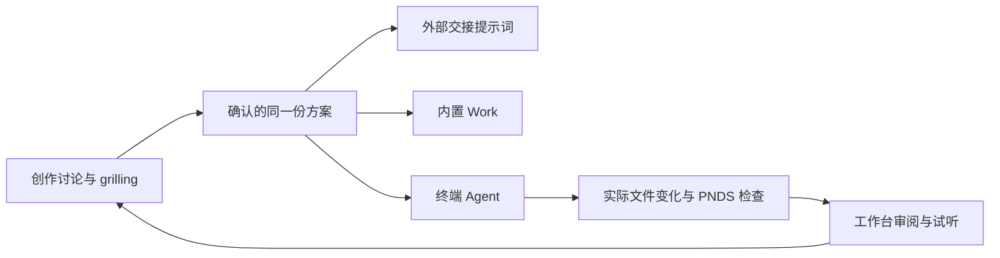
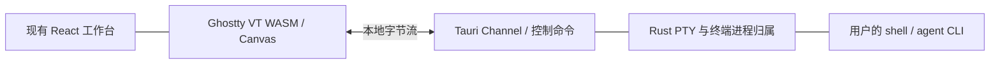

# 内置终端与 coding agent 协作评估

历史调研快照：本文记录最初发布候选的调查与失败复现。后续已采用固定 next wrapper 与显式修补 WASM，当前结论和验证证据见[工程终端](../developer/project-terminal.md)及[#353 采用记录](../acceptance/v1.7.0-beta.5-terminal-adoption.md)。原始发现保留为来源记录，不代表当前采用状态。

调查日期：2026-11-16。本文是评估笔记，不是实施规格。用户希望采用 libghostty，兼容用户已有 CLI，首批评估 Codex / Claude Code。本轮核对当前仓库及上游一手资料，没有安装终端依赖、启动 agent、读取用户 agent 配置或实现产品功能。

范围更新：用户已在[设计访谈 Q22](../plans/embedded-terminal-grilling.md#q22已确认收缩首版)确认首版收缩为「当前工程单终端 + 简单交接」。多工程后台、任务管理、自动写入锁、在线信息桥及完整实时换肤退出首版。本文保留技术能力与扩展成本评估，产品范围以收束后的访谈为准。

## 判断

本轮进一步收敛终端承载方案：推荐验证 **ghostty-web + 现有主 WKWebView + Rust PTY**，但当前 0.4.0 发布包有必须验证的生命周期问题。具体依据、最小能力与采用门槛见[接入选型收敛](#ghostty-接入选型收敛)。这是评估推荐，尚未成为实施决定。

值得继续验证。建议把目标定义为「PNDS 创作工作台中的终端与任务交接」，让内置创作助手承担创作讨论、grilling 和 PNDS 专用能力，让 coding agent 承担更自由的工程实现。两者通过同一份已确认任务、实际文件变化和检查结果合作。

终端引擎、任务交接、在线 PNDS 工具是三个独立问题。终端能运行 CLI，并不使 CLI 自动获得聊天、未保存草稿、私有素材语义或 App 运行状态。第一阶段可以用真实 PTY、单任务交接包和已有 `pnds check` 建立闭环；要达到与内置助手接近的信息能力，还需要后续在线桥。

## Ghostty：稳定 VT 与完整原生嵌入有不同边界

`libghostty-vt` 已于 2026-11-06 发布首个稳定版本 1.0.0，当前官方文档为 2026-11-11 发布的 1.0.1，C ABI 从 1.0 起稳定。它提供终端字节解析、屏幕、光标、滚动历史和 render state，宿主负责绘制和 PTY。它不是仅有 parser，也不是附带完整 GUI 的即用组件。[发布记录](https://lib.ghostty.org/vt/release-notes.html) · [公开接口](https://lib.ghostty.org/vt/index.html) · [首个终端示例](https://lib.ghostty.org/vt/first-terminal.html)

官方提供 macOS arm64/x86_64 的 GhosttyVt XCFramework 和 WASM。源码构建需要 Zig 0.17，预编译库有独立版本与签名校验路径；这些事实不代表本轮已下载验证产物。[安装与分发](https://lib.ghostty.org/vt/installing.html)

Ghostty 自身完整的 `include/ghostty.h` 仍明确称为 `libghostty-internal`，为其 macOS App 定制，不为外部使用设计；头文件建议外部消费者使用 `libghostty-vt`。因此不能把公开 VT ABI 的稳定承诺套到完整 Metal surface 嵌入上。[固定 vt-1.0.1 的 internal header](https://raw.githubusercontent.com/ghostty-org/ghostty/vt-1.0.1/include/ghostty.h) · [VT 稳定承诺](https://lib.ghostty.org/vt/stability.html)

| 候选路线                           | 对 PNDS 的价值                                         | 主要成本                                                                        | 建议                                                      |
| ---------------------------------- | ------------------------------------------------------ | ------------------------------------------------------------------------------- | --------------------------------------------------------- |
| `ghostty-web` + Rust PTY           | 在现有 React 布局中使用 Ghostty VT 与现成 Web renderer | 第三方适配、WKWebView 的 IME/显示兼容、WASM 分发；当前并非直接消费官方 VT 1.0.1 | 最先验证，适合测试「保留 Ghostty 内核且改动较小」能否成立 |
| 公开 VT C ABI + 自建原生 renderer  | 使用稳定公开接口，显示与进程可以独立                   | 字体、字形、绘制、输入法、选择、无障碍均有较大工作量                            | 不宜作为轻量首选                                          |
| 完整 internal API + AppKit adapter | 最接近 Ghostty.app 原生体验                            | 固定上游版本、FFI、原生视图/输入/生命周期及升级维护                             | 原生 Metal 体验为硬要求时单独验证                         |
| xterm.js + 同一个 Rust PTY         | 提供不依赖 Ghostty 的对照                              | 需要接受替换终端引擎                                                            | 用于比较兼容性与资源指标，不预先替代用户偏好              |

`ghostty-web` 的维护者是 Coder，README 提供 npm 包和 xterm.js 风格 API；其实现有 Canvas renderer，并仍使用 Ghostty submodule 加 patch，README 把转向官方 WASM 描述为未来工作。因此不能将它等同于官方 1.0.1 分发，或 Ghostty.app 的 Metal renderer。正式验证需固定 wrapper、patch 与 Ghostty revision。[项目说明](https://github.com/coder/ghostty-web) · [renderer](https://github.com/coder/ghostty-web/blob/main/lib/renderer.ts) · [patch](https://github.com/coder/ghostty-web/blob/main/patches/ghostty-wasm-api.patch)

原生路线已有外部产品先例：cmux 使用 Ghostty 构建 macOS 原生终端并围绕 agent 做通知与编程接口。这证明方向可行，不证明它是 Tauri 的即用组件或 PNDS 的维护成本很低。[cmux](https://github.com/manaflow-ai/cmux)

Ghostty 与 ghostty-web 的核心许可为 MIT；实际分发仍需按选定产物保留许可并核对字体及附带依赖。这里没有建议复制其他终端产品的代码。[Ghostty 许可](https://raw.githubusercontent.com/ghostty-org/ghostty/vt-1.0.1/LICENSE) · [ghostty-web 许可](https://github.com/coder/ghostty-web/blob/main/LICENSE)

## 仓库中可复用的基础

| 能力                    | 当前事实                                                                                  | 接入意义                                                          |
| ----------------------- | ----------------------------------------------------------------------------------------- | ----------------------------------------------------------------- |
| grilling 后选择执行方式 | `AssistantWorkflowCard` 有交接与 Start work；同一公开计划及已提交答案可以进入新 Work 任务 | 第三动作可共用计划选择，不必再付费摘要或重复询问                  |
| 外部任务交接            | 已有审阅、Record、task/revision、源文件基线、历史归档与比较                               | 可参考范围区分；Q22 的静态交接不新增任务记录或自动比较基线        |
| 外部文件修改            | 工作台轮询磁盘，干净编辑器采用保存版，脏草稿保留冲突                                      | agent 的保存自然回流，不必复制一套编辑器                          |
| 保存版与运行版区别      | 页面变更提示刷新，服务变更提示重启，SCD 变更提示编译                                      | agent 写完不能直接报告作品已加载                                  |
| 静态/受控检查 CLI       | `pnds check` 与 App 共享诊断服务；受控运行共享 RuntimeLease                               | 第一阶段任意 agent 可使用，不必先实现 MCP                         |
| 原生视图                | 现有 objc2 模块已有 sibling NSView 挂载、bounds、hide/focus                               | 降低原生宿主骨架成本，仍不能替代 Ghostty 的输入与 surface adapter |

本地依据：[讨论到工作](../developer/creation-assistant.md#discussion-to-work-and-handoff-2026-10-21) · [动作组件](../../src/components/creation/AssistantWorkflowCard.tsx) · [工作台](../developer/creation-workspace.md) · [交接基线](../developer/handoff-baselines.md) · [静态诊断](../developer/static-diagnostics.md) · [受控检查](../developer/controlled-checks.md) · [CLI](../../src-tauri/src/bin/pnds.rs) · [原生页面](../../src-tauri/src/project_media_view/native.rs)

现有 CLI 示例中的 `pnds` 表示 App 实际安装路径下的命令，不假设已在 PATH：

```text
pnds check <project> --json
pnds check <project> --run --json
pnds check <project> --run --mode internal --compile --json
```

它当前公开命令是 `check`，没有在线 App 状态或文档检索 RPC。受控运行使用保存版临时副本并遵守运行互斥；CLI 没有桌面 WebKit observer，不能声称有 App adapter 的 `browserScripts` 证据。[CLI 调用契约](../../src-tauri/src/bin/pnds.rs) · [桌面观察差异](../developer/controlled-checks.md#desktop-page-observation)

## 第三个按钮如何形成可靠交接

建议文案为「交给终端 Agent」。按 Q22，动作生成本次方案的静态任务文件，复制短提示并切到当前工程的唯一终端；用户自行启动或使用已有 CLI，在就绪后提交。可以保存一个常用启动命令，不新增首次 Agent 选择向导、专属 Agent 标签或独立任务记录。明确配置的新 CLI 可通过参数接收短提示，自动传参不是首次验证的前置条件。



这里有一个现有语义陷阱：外部复制提示词和 bundled handoff skill 要求完成 `docs/creator-handoff.md` 中的**全部当前任务**。新按钮若指向这次 grilling 方案，必须捕获该方案的独立 task scope，不能直接复用这个通用提示词。[现有外部指令](../../src-tauri/resources/skills/pnds-handoff/SKILL.md) · [交接提示词归属](../developer/handoff-baselines.md)

Q22 的静态交接内容：确切公开方案及已确认决策、目标与非目标、验收、工程保存版位置、相关装机文档路径和现有检查用法。可附导出当时的明确标时概况，但不以运行中状态查询为前置。固定结构可以由宿主生成，不必把整个聊天再交给模型改写。不默认导出其他聊天、未保存选区或私有素材；独立 task/revision、自动比较基线与动态素材读取属于后续扩展。

首版使用本次方案的静态上下文文件，复制短的任务入口；不向任意已经运行的 PTY 自动粘贴长提示词。若配置启动参数，以结构化 executable/argv/cwd/env 处理路径和参数，不拼接用户内容为 shell 命令。临时交接数据不改写现有项目 AGENTS，不写全局 agent 配置；实际私有落点与打包排除规则留到技术验证时核对。

首版不新增终端任务结束或完成状态。进程退出、TUI 标题、屏幕出现「完成」都不能直接表示需求实现；用户通过现有磁盘 diff、真实检查及人工试听审阅，不把普通 shell 的改动标成内置助手的任务 journal/整任务撤销。机器回执与结构化任务协议留作后续方向。[当前写入与证据边界](../developer/creation-assistant.md) · [单文件变更](../developer/single-file-changes.md)

## 信息与操作能力分层

| 层次                   | agent 可获得什么                                                                      | 仍缺什么                                     |
| ---------------------- | ------------------------------------------------------------------------------------- | -------------------------------------------- |
| 普通终端               | 已安装工具、shell、保存版工程文件                                                     | PNDS 的在线上下文与受管操作                  |
| 单方案交接 + 现有 CLI  | 目标、已确认决策、装机资料指针、保存版位置、检查 JSON                                 | 当前 App 状态、私有素材语义、实时日志等      |
| 只读 PNDS bridge / MCP | 当前工程身份、保存版与运行版、装机帮助检索、选定素材、当前运行状态/日志、真实检查结果 | 受管写入、编译、测试等操作仍需独立 admission |
| 后续受管操作桥         | 按现有 owner/version/runtime gates 提供编译、受控检查、预演等                         | 普通 shell 本身仍不是 PNDS 受控 writer       |

后续桥接方向：MCP 可以给 TUI 内的 agent 提供 PNDS 工具和数据，无需先接管其 agent loop。Codex 支持 MCP，Claude CLI 可注入本次会话的 MCP 配置。若将来采用，可考虑会话级配置、工程/任务作用域及短期能力凭据；具体传输尚未选定，均不是首版前置。[Codex MCP](https://learn.chatgpt.com/docs/extend/mcp?surface=cli) · [Claude CLI](https://code.claude.com/docs/en/cli-reference)

不能原样转发整个 `assistant-tools.json` 就宣称兼容。当前 writer 依赖 native task、实际已读证据、版本、草稿保护与问题/资源授权。新桥应复用 domain service，拥有自己的调用准入。私有素材应继续使用 ID/版本语义，合并候选仍属于独立候选作用域。[工具与持久接续](../developer/creation-assistant.md#shared-tool-contracts-and-durable-task-continuation-2026-10-18) · [私有资料](../developer/pending-documents.md) · [合并候选](../developer/merge-candidates.md)

普通 shell 具有其用户进程权限，cwd 只是起点。PNDS bridge 限制的是 PNDS 工具，不能阻止 CLI 直接通过 shell 写文件。Q22 已将 App 调度层的串行修改与自动只读移出首版，由用户协调并发修改，复用现有外部变化和草稿冲突处理；这些机制不能被描述成对任意 shell 或外部编辑器的硬隔离。

## 保留 TUI 与程序化 agent 的选择

| 路径                                    | 用途                                                 | 与原生 TUI 的关系                        | 当前建议                           |
| --------------------------------------- | ---------------------------------------------------- | ---------------------------------------- | ---------------------------------- |
| PTY 启动用户 CLI                        | 人与 agent 直接互动，保留安装、登录、审批及 CLI 习惯 | 保留                                     | 首批 Codex / Claude Code           |
| MCP                                     | 给 agent 提供 PNDS 数据和工具                        | 可与 TUI 同时使用                        | 后续按真实需要验证，不是既定第二步 |
| Codex `exec --json` / Claude print mode | 后台任务、机器事件与结果                             | 是另一种运行模式                         | 确有后台任务需求时再接             |
| Codex App Server                        | 会话、事件、审批、恢复等深度控制                     | 通常由 client 呈现；另有 remote TUI 路径 | 独立验证                           |
| ACP client + provider adapter           | 多 agent 的会话与工具事件协议                        | 不是自动嵌入各家 CLI TUI                 | 多 provider 深度交互需求明确后考虑 |

MCP 提供工具/数据，ACP 连接 client 与 agent，两者互补。当前 ACP 官网区分 v1 Latest 与 v2 Draft；Codex/Claude 接入依赖适配器，增加兼容版本层。[协议关系](https://agentclientprotocol.com/get-started/related-protocols) · [会话设置](https://agentclientprotocol.com/protocol/v1/session-setup) · [适配器列表](https://agentclientprotocol.com/get-started/agents)

后续采访前核对：Codex 的 -c/--config 与 Claude 的 --mcp-config 可为单次启动注入 MCP，无需改工程或全局配置；Claude 的 strict-mcp-config 会排除原有 MCP，不宜无意启用。这些参数只影响所启动进程，因此普通 shell 后续输入的裸 codex/claude 命令不会自动获得 PNDS 的临时配置，这是参数作用域的推论。[Codex 单次覆盖](https://learn.chatgpt.com/docs/config-file/config-advanced#one-off-overrides-from-the-cli) · [Claude CLI](https://code.claude.com/docs/en/cli-reference)

两 CLI 都有明确新会话、按 ID 恢复及本地认证状态查询入口，但不能把最近一次会话自动等同本次 PNDS 任务。Claude 可指定新会话 ID，本轮 Codex CLI 文档未找到对等入口；纯 TUI 方案在不读历史或解析输出的条件下，不能先承诺两者统一精确自动恢复。CLI 自带恢复选择器是后续产品候选，恢复时也应重新注入本次 PNDS 配置。本轮未执行 CLI 或读取用户凭据。[Codex 命令](https://learn.chatgpt.com/docs/developer-commands?surface=cli) · [Claude 会话参数](https://code.claude.com/docs/en/cli-reference#cli-flags)

后续用户明确要求避免逐个 Agent 适配。需要区分「统一 PNDS 能力接口」与「自动配置/接管各家 CLI」：MCP 原本就支持一套服务向不同兼容客户端提供工具，并不要求按客户端重写 PNDS 业务服务；各 CLI 的启动、配置、会话和通知方式则仍有差异。[MCP 架构](https://modelcontextprotocol.io/docs/learn/architecture)

早期 Q11-R 曾确认通用启动配置 + 任务文件 + PNDS 只读 CLI，Q22 已替换该扩展首版。当前仅保留静态文件、可选一个常用启动命令及现有检查 CLI，不新增在线信息命令。后续若要提供实时信息，仍需本地 App IPC、工程/任务读取作用域、版本及错误契约和帮助检索接缝，不能宣称为零成本包装。CLI 路径能省去部分逐客户端注册，不代表比用户一次配置统一 MCP 服务的总开发量更小。

静态任务文件可统一目标、范围与参考入口，但没有对任意 CLI 生效的统一初始提示参数或就绪信号。由用户在 CLI 准备好后提交短提示；明确配置的新 CLI 可以通过参数接收。首版不自动判断任务完成，也不从任意 TUI 文本推断。产品确认见[Q22](../plans/embedded-terminal-grilling.md#q22已确认收缩首版)。

后台任务已有正式机器接口：Codex `exec --json` 提供 JSONL，Claude print mode 支持 `stream-json`，各有会话接续参数。适配器应保存真实 provider session 标识；终端滚动历史不能替代 agent 会话恢复。[Codex 非交互模式](https://learn.chatgpt.com/docs/non-interactive-mode) · [Claude CLI](https://code.claude.com/docs/en/cli-reference)

Codex 官方还提供 `codex --remote` 连接 app-server 的 TUI 路径，值得研究保留 TUI 同时桥接事件；但 WebSocket transport 标注 experimental，同 thread 多 client 的控制/审批归属和断线接续未在本轮验证。不能先承诺两个 UI 无缝控制同一任务。[App Server](https://learn.chatgpt.com/docs/app-server)

用户在普通终端中自行登录 CLI，与 PNDS 提供内置 SDK 登录是不同产品路径。当前 Codex app-server 认证文档区分本地/开源应用与商业托管用途；Claude SDK 明示第三方未经批准不能提供 claude.ai 登录/订阅额度。后续深度集成需要按实际发行和认证方式核对，首版不读取或复制 agent token，也不把 PNDS 模型密钥和运行秘密注入终端。[Codex 认证](https://learn.chatgpt.com/docs/app-server#auth-endpoints) · [Claude SDK](https://code.claude.com/docs/en/agent-sdk/overview)

## 其他值得探索的合作方式

| 场景                             | 价值                                      | 需要的基础                                                |
| -------------------------------- | ----------------------------------------- | --------------------------------------------------------- |
| 错误、选区或检查报告发送给 agent | 减少手动复制，直接定位工程问题            | 显式选择、工程身份、保存版本与可读诊断                    |
| agent 完成后回到创作助手评审     | 助手用创作目标解释 diff、检查报告和试听项 | 实际结果引用，不能只接受 agent 自评                       |
| 工程维护与依赖问题               | 使用用户熟悉的 npm、Git 和工具链          | 真实终端与明确写入归属                                    |
| PNDS 专家问答                    | 让 CLI agent 查询装机契约、素材与运行事实 | 只读 PNDS MCP，保留来源版本                               |
| 专属实验副本                     | 让 agent 尝试较大改造并由创作者审阅       | 独立副本/候选机制及明确合并；不是给当前候选直接开放 shell |
| 终端任务等待提醒                 | agent 等用户时跳回对应工程与 session      | 官方 hook/结构化事件；不依赖猜测屏幕文字                  |
| 后台编译/检查助手                | 用户继续讨论时收集真实报告                | 程序化 adapter、运行互斥和结果归属                        |

最有价值的角色分工是：创作助手掌握创作意图与 PNDS 专用流程，coding agent 负责广泛工程任务，PNDS 提供现有工程审阅与检查。首版以显式方案交接建立合作；用户自行协调执行者，不新增串行调度或自动验收系统。

## 终端本身需要验证的约束

收束后的[设计访谈](../plans/embedded-terminal-grilling.md#q22已确认收缩首版)已由创作者选定：终端与创作助手、版本历史在同一主工作区并列切换，全 App 仅当前工程一个会话，shell 与 agent 共用。该选择替代研究阶段的底部面板建议及旧访谈的双标签、多工程后台方向。现有独立日志控制台仍是运行观察入口。

PTY 与 agent 的生命周期独立于演出 SessionManager。隐藏面板不结束进程，换工程不把旧 agent 自动移到新 cwd，退出处理活跃进程且不得误杀演出；恢复 session 元数据不等于重建了运行中的进程。现有 SupervisedChild 的进程归属/有界清理思想可参考，具体 PTY/process group 适配需验证。[受管子进程](../developer/rust-architecture.md#supervised-child-processes-childrenrs) · [运行契约](../zh-CN/reference/runtime-contract.md)

Tauri v2 有原生 view pointer 与流式 Channel。Web 路线应比较二进制分批/背压与现有事件通路，避免逐字节发送或用输出洪流阻塞 UI；是否引入 Channel 是终端专用设计选择。WASM 要验证本地资源与 CSP，Tauri 文档提示 `script-src` 的 `'wasm-unsafe-eval'`，无需因此放开普通 `'unsafe-eval'`。[Tauri v2 前端通信](https://v2.tauri.app/develop/calling-frontend/) · [原生窗口 API](https://docs.rs/tauri/latest/tauri/webview/struct.WebviewWindow.html) · [Tauri v2 CSP](https://v2.tauri.app/security/csp/)

## 建议的下一轮验证

1. **显示与输入**：固定一个 Ghostty Web 候选，使用真实 Rust PTY 跑已安装 Codex / Claude Code。验证中文 IME、组合字符、emoji、长粘贴、选区复制、Ctrl-C/Ctrl-D、作业控制、alternate screen、resize/reflow、CLI 审批与接续。若原生 Ghostty 外观/Metal 为硬要求，再并列做小范围 native embedding 验证。
2. **简单交接**：用 Blank 的一个真实需求完成 grilling → 第三动作 → 当前方案静态文件与短提示 → 用户提交给 CLI → agent 修改 → watcher 冲突保护 → `pnds check` → diff/人工试听。注入一个旧交接任务，确认本次不会误执行它；不新增终端任务记录或自动比较基线。
3. **运行与生命周期**：验证 Finder 启动后的 shell/PATH、空格中文路径、缺失 CLI、切换工程、隐藏窗口、睡眠唤醒、停止与退出，确认进程归属和清理；运行检查遇到演出占用应如实返回阻塞，不能自行启动第二套音频资源。
4. **轻量指标**：记录包增量、首开耗时、空闲及隐藏 CPU/RSS、高输出下输入延迟、滚动历史上限；和音频/monitor 同时运行时检查音频稳定性。库小或 GPU 加速本身不足以证明整个功能轻量。
5. **后续方向**：首版验证不包含在线工具。根据实际使用缺口，再决定是否研究只读 PNDS CLI/MCP、受管操作、App Server 或 ACP。

本轮没有对上述候选进行编译、UI、双架构安装包或真实 agent 端到端验收。VT 产物可用性来自官方文档，未实下载校验；第三方 main 链接是调查时快照。正式验证前应固定版本与 commit，再依据数据选择路线。Context7 在本会话工具清单中未发现，框架资料回退到 Tauri v2 官方文档。

## Ghostty 接入选型收敛

补充调查于同日，聚焦「轻便且足够运行基础 shell、Codex / Claude Code TUI」。**推荐以 ghostty-web 的 WASM / Canvas 终端组件配 Rust PTY，直接放在现有主 WKWebView 中。** 在 PNDS 现有 React/Tauri 架构下，这是预计集成负担较低、值得优先验证的候选；尚无测量证明它的总维护成本、CPU、RSS 或最终包增量都小于原生路线。当前发布包不能未经验证就作为产品实现锁定。



### 为什么优先选择这条路线

| 成本              | Web 组件 + Rust PTY                  | 完整原生 Ghostty                                     | 公开 VT + 自建 renderer                   |
| ----------------- | ------------------------------------ | ---------------------------------------------------- | ----------------------------------------- |
| 新增显示宿主      | 现有 DOM 内的容器                    | 同窗口增加 NSView 及原生输入桥                       | 另建 renderer 与输入层                    |
| 已有终端核心      | 组件提供 VT、Canvas、输入与选区      | 完整引擎提供 PTY、字体、渲染                         | 仅 VT / render state 由上游提供           |
| PNDS 主要新增工作 | PTY supervisor、字节桥与局部兼容修补 | C FFI、AppKit 输入/布局/生命周期及 internal API 维护 | PTY、渲染、字形、输入、选择等完整宿主工作 |
| 初步判断          | 优先验证，集中新增工作               | 性能或输入门槛无法满足时重比成本                     | 工作量最不符合当前轻量目标                |

Web 路线可以复用 PNDS 已有 WebView、Rust 主进程、系统等宽字体与 CJK/emoji fallback；终端基础设施不需要新增 Node/Bun 服务、HTTP/WS listener、另一套浏览器或完整 Ghostty 窗口系统。`ghostty-web` 的 transport API 是 onData/write/onResize，demo 的 WebSocket server 并非必需组件。[发布 API](https://app.unpkg.com/ghostty-web@0.4.0/files/dist/index.d.ts) · [组件用法](https://github.com/coder/ghostty-web)

PTY 建议优先评估 Rust `portable-pty`，它提供 openpty、spawn、read/write、resize 和 child 接口，不是常驻服务。PNDS 仍需补自己的进程归属和有界清理，不能把其 Child trait 直接塞入持有 `std::process::Child` 的现有 SupervisedChild。[portable-pty 0.9.0](https://docs.rs/portable-pty/0.9.0/portable_pty/) · [现有进程监督](../../src-tauri/src/project/children.rs)

Tauri Channel 适合高频有序输出；应用层仍需实现有限队列、分批与消费背压，Channel 本身不是完整的背压策略。控制与低频状态沿用 PNDS 的类型化命令/事件。终端字节与逐帧绘制不进入 React/Zustand 状态更新。[Tauri 流通路](https://v2.tauri.app/develop/calling-frontend/) · [本地桥约定](../developer/tauri-commands.md)

### 实际发布包与必要修补

进一步核对了实际 npm `ghostty-web@0.4.0` 分发，而非仅查看 main。发布 manifest 无 runtime dependencies；GitHub 同名 tag 的 manifest 仍写 0.3.0，因此版本资格以实际发布包为依据。[发布 manifest](https://app.unpkg.com/ghostty-web@0.4.0/files/package.json) · [tag manifest](https://raw.githubusercontent.com/coder/ghostty-web/v0.4.0/package.json)

发布清单中的 ESM 为 682 kB、WASM 为 423 kB，另有 UMD、声明及重复 WASM 文件。约 400KB 只是 WASM 口径；默认 ESM loader 还存在内嵌 data URI，不能简单相加得到最终 App 增量。应显式打包本地 WASM、检查实际 Vite 输出，再测 DMG 和内存；本轮未做这些测量。[发布清单](https://app.unpkg.com/ghostty-web@0.4.0/files/dist) · [WASM 加载问题 #188](https://github.com/coder/ghostty-web/issues/188)

| 项目           | 核对结果                                                                                  | 最小处理与资格                                                                                                         |
| -------------- | ----------------------------------------------------------------------------------------- | ---------------------------------------------------------------------------------------------------------------------- |
| 中文输入与 TUI | 已有 composition、Unicode cell、alternate screen、terminal response、选区及 resize 的实现 | 在 WKWebView 用目标版本的 Codex/Claude 实测，源码存在不代表兼容验收通过                                                |
| 长多行粘贴     | Terminal.paste 支持 bracketed paste；部分原生 paste 路径直接发送 raw text                 | 外层统一文本 paste 进入公开 paste API；不需要为这一点 fork，不应一概截获 CLI 的所有 Ctrl-V 用途                        |
| 本地 WASM 加载 | 默认 init 路径的 data URI 与严格 CSP 有冲突报告                                           | 候选为 Ghostty.load(localWasmUrl) 后通过 options.ghostty 注入；核对生产包及 wasm-unsafe-eval，不放宽成普通 unsafe-eval |
| 空闲/隐藏绘制  | 发布版无条件延续 rAF，无公开暂停后保留状态接口                                            | 为可见性/按需绘制维护一个局部补丁；CSS 隐藏不等于停止循环，隐藏仍消费输出并保留 VT 状态                                |
| 释放与重建     | #141 / #210 报告共享 WASM heap 在复杂 emoji 或滚动历史后 free/new 越界，仍未关闭          | 采用前必须验证；每 terminal 独立 WASM instance 是报告中的规避候选，需同时测内存与重复销毁，不能视为已解决              |

实现依据：[输入路径](https://raw.githubusercontent.com/coder/ghostty-web/v0.4.0/lib/input-handler.ts) · [终端组件](https://raw.githubusercontent.com/coder/ghostty-web/v0.4.0/lib/terminal.ts) · [发布 ESM](https://app.unpkg.com/ghostty-web@0.4.0/files/dist/ghostty-web.js)。故障报告为上游仓库中的用户报告，**本轮未独立复现**：[#141](https://github.com/coder/ghostty-web/issues/141)、[#210](https://github.com/coder/ghostty-web/issues/210)、[#208](https://github.com/coder/ghostty-web/issues/208)。不能将报告中的 Chromium 开销数字直接套给 PNDS 的 WebKit。

建议首次使用时才加载组件/WASM，只保留必要会话，限制滚动历史。每会话独立 instance 的候选设计可以隔离共享 heap，但会增加内存开销；后续可研究复用编译模块而隔离 instance。局部调度补丁应固定版本并可审阅，避开运行时修改私有字段或替换全局 rAF。若必须大改 WASM 内部或重写 renderer，需重新比较原生路线的总代价。

### 最必要的能力边界

首轮验收至少覆盖：真实 PTY 与作业控制；shell/cwd/env 和 Finder 启动后的 PATH；ANSI/颜色/光标/alternate screen/终端查询回写；中文 IME 与复杂 Unicode；长粘贴与复制；resize/SIGWINCH；Ctrl-C/Ctrl-D/Ctrl-Z；bounded scrollback；输入焦点与 App 快捷键归属；EOF、退出码和进程清理。Ctrl-C 应交给 PTY 前台作业，不默认等同结束整个终端。

切换视图或隐藏窗口时保留会话；切换工程、替换工程版本、进入合并候选、离开创作或退出 App 前结束当前活跃会话或取消原操作。不能把旧 agent 自动切到新工程，结束失败不能先宣称已结束。音频会话与终端 supervisor 独立。数据大流量时要保留 UTF-8 跨 chunk 的原始字节，不能每块独立有损解码，也不能积累后反复把全量输出送往前端。

分屏、SSH 管理、主题市场、图片协议、复杂 shell integration 与全套终端配置不是当前基本用途的前提。发布版未找到搜索 API，Canvas 输出的完整屏幕阅读器可访问性也没有通过核对，应作为明确缺口保留，不能把 xterm.js 风格 API 当成其全部生态能力。[无障碍评估报告 #187](https://github.com/coder/ghostty-web/issues/187)

agent 获取 PNDS 上下文与工具仍由任务交接/工具桥提供，与采用 Web 或原生 renderer 独立。终端最小化不应削减正确输入、进程清理和工程归属。

### 原生路线何时更合适

原生完整 surface 本来就管理 PTY、IO 与 renderer；不应再给它并排加一套 Rust PTY 字节桥。PNDS 可用现有 objc2 加 C FFI，不强制加入 Swift，也不必捆绑整个 Ghostty.app；macOS 默认字体后端是 CoreText，不能把 Fontconfig 算作必然新增负担。不过 AppKit 的 IME/key/mouse/focus/scale/occlusion、原生弹层遮挡和释放仍需适配，且 internal API 没有公开 VT ABI 的兼容承诺。[完整接口](https://raw.githubusercontent.com/ghostty-org/ghostty/vt-1.0.1/include/ghostty.h) · [Surface](https://github.com/ghostty-org/ghostty/blob/main/src/Surface.zig) · [字体后端](https://github.com/ghostty-org/ghostty/blob/main/src/font/backend.zig)

核对时 main 的原生构建还有 FreeType/默认字体等资源因素，未测过最终可裁剪产物，因此不能声称 Web 包体必然最小。官方公开 VT WASM 则有全功能 small 构建，但尚未提供能直接替换 Web 组件的完整 Canvas renderer；切换官方 ABI 不是替换一个文件即可完成。[构建依赖](https://github.com/ghostty-org/ghostty/blob/main/src/build/SharedDeps.zig) · [官方 WASM](https://lib.ghostty.org/vt/installing.html) · [示例](https://github.com/ghostty-org/ghostty/tree/main/example/wasm-vt)

若 Web 路线在中文输入、目标 TUI、反复开关/缩放或音频并行负载中不能通过，或者维护补丁超出局部修补范围，就把完整 native embedding 作为下一候选。当前最小验证应先做这些门槛，再决定出货依赖；本轮没有下载执行发布包或完成性能测量。

### 主题适配补充核对

用户随后明确要求终端适配当前 PNDS 主题。App 的主题源是 `src/theme-variables.css`，当前选择由 `color-theme.ts` 与 settings store 管理；主题桥的通用语义色子集并不是完整终端色板。复用现有主题源，再补终端颜色角色，比创建独立主题状态更符合仓库约定。[主题机制](../../src/lib/color-theme.ts) · [表面与颜色约定](../developer/ui-patterns.md)

发布 `ghostty-web@0.4.0` 的 ITheme 有默认前景/背景、光标、选区和 ANSI 16 色，但没有整个 256 色表的配置接口。动态赋值 options.theme 只提示未完整支持；renderer.setTheme 更新 renderer 自身配置，不足以完整更新 WASM 已解析的文字前景、背景和 ANSI 色。不能仅改变 CSS 或调用 renderer setter 就宣称已有会话已完整换肤。[发布类型](https://app.unpkg.com/ghostty-web@0.4.0/files/dist/index.d.ts) · [发布实现](https://app.unpkg.com/ghostty-web@0.4.0/files/dist/ghostty-web.js)

对应 v0.4.0 的 colorOperation/kittyColorOperation 是 no-op，明暗查询也未支持；用 OSC 4/10/11 注入替代完整主题更新，或声称 CLI 已能自动识别 App 明暗，均没有实现依据。初始化色值解析需具体 RGB，不能直接传 CSS var/任意 CSS color；底层用零表示未设置，纯黑的表达也要验证。[颜色操作与配置](https://github.com/coder/ghostty-web/blob/v0.4.0/patches/ghostty-wasm-api.patch#L676) · [色值解析](https://github.com/coder/ghostty-web/blob/v0.4.0/lib/terminal.ts#L240)

Q22 已将完整实时换肤后置，首版只在新建会话时初始化当前主题：PNDS 管理默认色与标准 16 色，CLI 明确指定的其他扩展色/RGB 保留，纯黑与四套主题可读性仍需验证。若将来要求运行中即时跟随，应另行验证保留 PTY/terminal state 的默认颜色与 palette 更新、完整重绘及背景查询；不能通过 reset/free 或重启 agent 达成配色切换。范围依据见[设计访谈](../plans/embedded-terminal-grilling.md#q22已确认收缩首版)。
